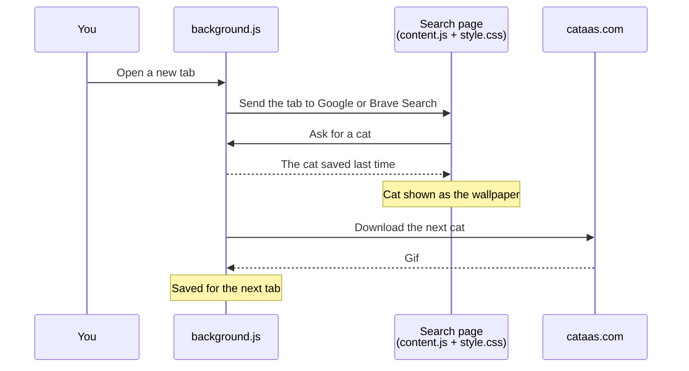

# Tabby Tab – Cat wallpaper

A browser extension that puts a random cat gif behind your search page every time you open a new tab.

## Features
- Every new tab opens your browser's search homepage with a full-screen cat gif from [CATAAS (Cats as a service)](https://cataas.com/) as the wallpaper.
- The cat appears instantly: it was downloaded in the background while you were using the previous tab.
- Only blank new tabs are changed. Links you open in a new tab load as normal.

| Browser | New tab opens |
|---|---|
| Brave | Brave Search |
| Chrome, Edge and other Chromium browsers | Google |

Edge opens Google rather than Bing because Edge doesn't let extensions run on Bing.

## How it works
Chromium doesn't let extensions change its built-in new tab page, so the extension sends new tabs to a search homepage and puts the cat behind it there.

Downloading a gif takes a few seconds, which is too slow for a new tab. So each tab shows the cat that was saved last time, and the next one downloads in the background. The very first tab after installing waits for its download.

If a download fails, takes over 2 minutes, isn't an image, or is over 40MB, the saved cat is kept and the next tab tries again.

### Files
| File | What it does |
|---|---|
| `manifest.json` | Declares the extension, its permissions, and which pages the scripts run on |
| `background.js` | Sends new tabs to the search page, downloads and saves cats, and hands them to tabs |
| `content.js` | Runs on the search page: asks for a cat and sets it as the page background |
| `style.css` | Lays the cat out as a full-screen wallpaper |
| `brave.css` | Hides the layers Brave Search draws over its background |

## Installation (Developer Mode)
1. Clone or download this repository.
2. Open your browser's extensions page:
   - Chrome: `chrome://extensions/`
   - Brave: `brave://extensions/`
   - Edge: `edge://extensions/`
3. Turn on **Developer mode**.
4. Click **Load unpacked** and select the `cat-dynamic-theme-chrome-ex` folder.
5. Open a new tab and enjoy the cats!

After changing the code, click the reload icon on the extension's card to load your changes.
